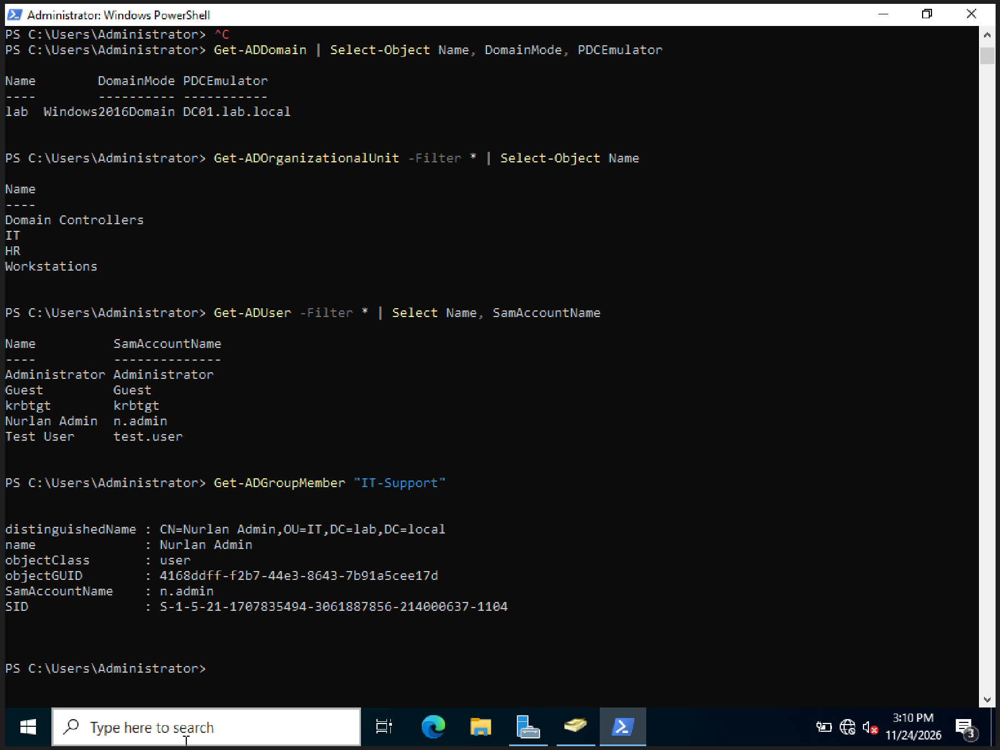
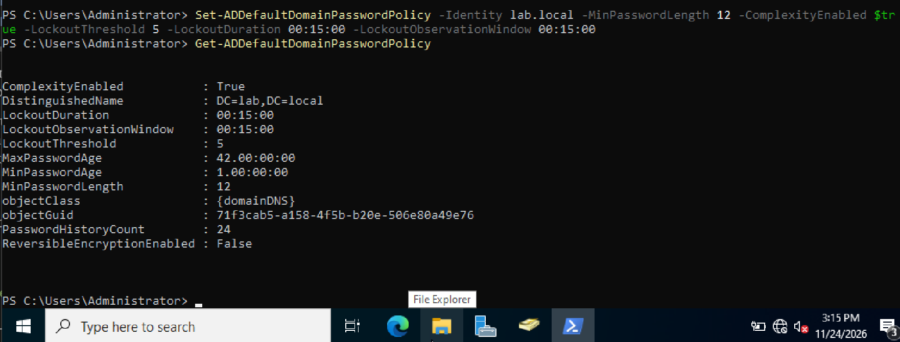
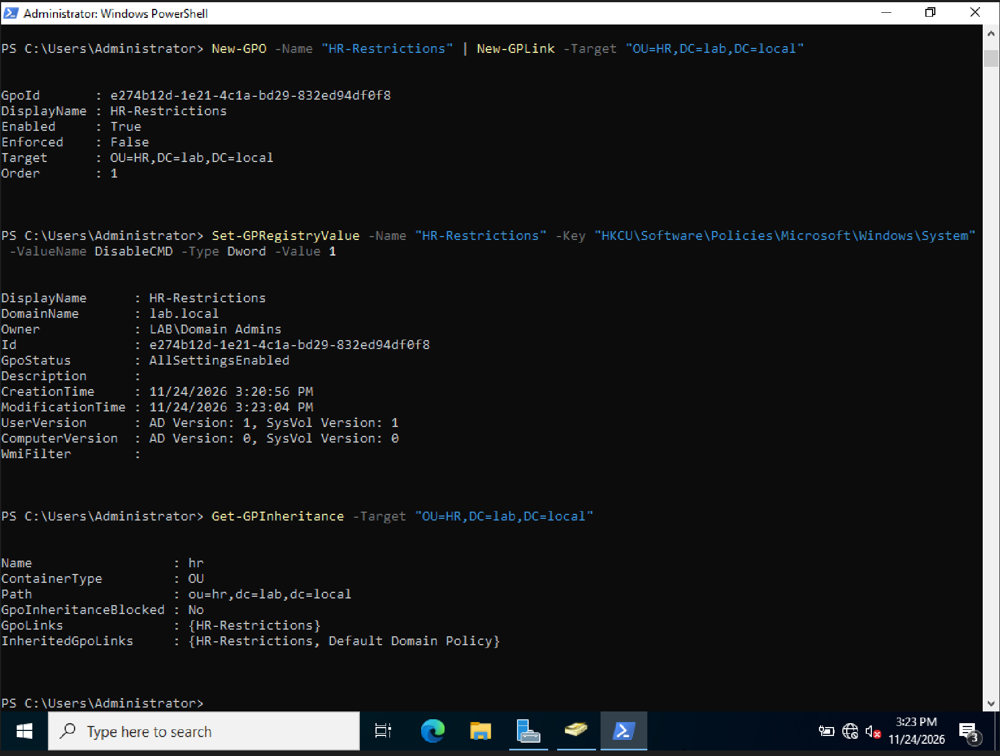
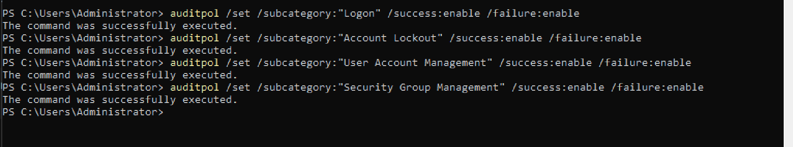
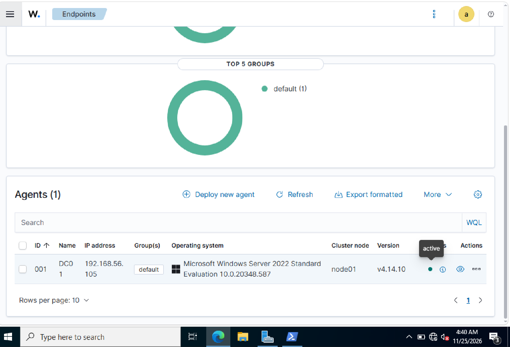
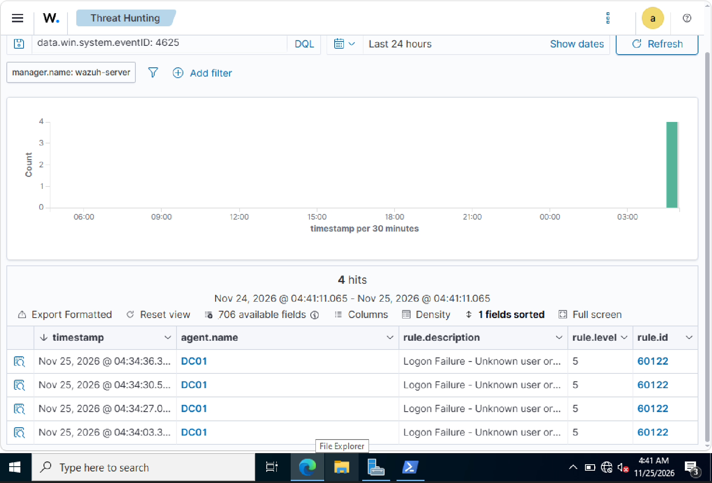
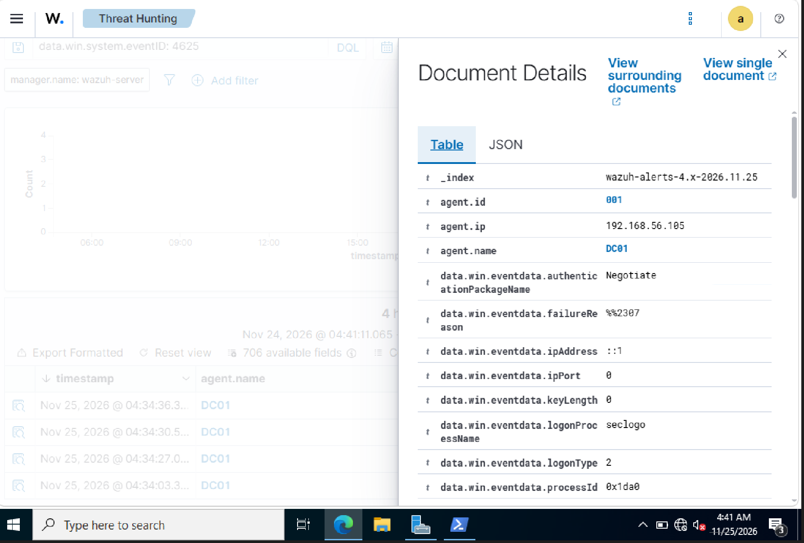

# AD & Wazuh SIEM Lab

A small **training project**: a Windows Server Active Directory lab monitored with the Wazuh SIEM.

## Lab setup

- VirtualBox with two VMs: a Windows Server 2022 domain controller (`DC01`, domain `lab.local`) and a Wazuh server (official OVA, v4.14.10)
- Host-only network between the VMs, Wazuh agent installed on DC01

## What I did

- Set up DC01 as a domain controller (AD DS and DNS)
- Created OUs (IT, HR, Workstations), users and a security group (`IT-Support`)
- Configured a domain password and account lockout policy (12+ characters, complexity, lockout after 5 attempts)
- Created a GPO (`HR-Restrictions`) and linked it to the HR OU (not tested on a client machine)
- Enabled audit policies for Logon, Account Lockout, User Account Management and Security Group Management
- Connected DC01 to Wazuh and generated failed logons with wrong passwords

## What I found

- Failed logons show up in Wazuh as Windows event `4625` (rule `60122`, level 5, "Logon Failure - Unknown user or bad password")
- The event details include the logon type, logon process, authentication package and failure reason

## Screenshots

